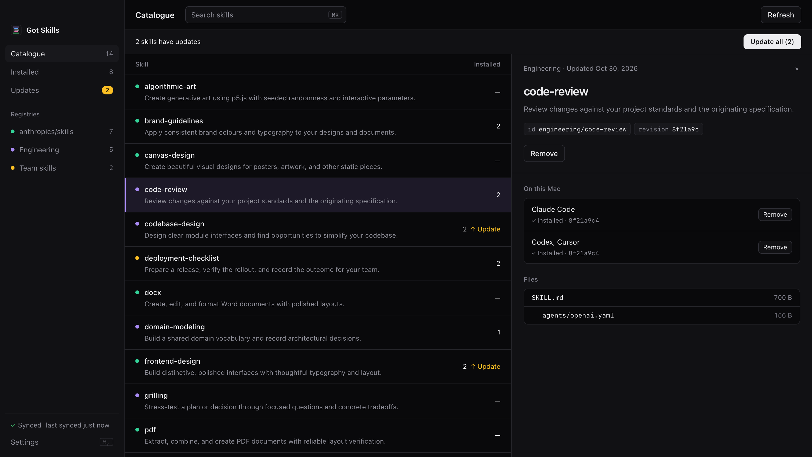
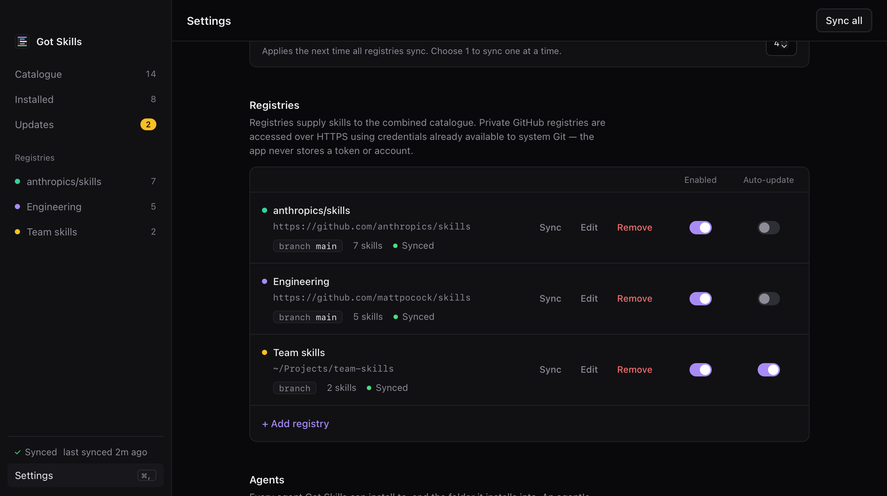
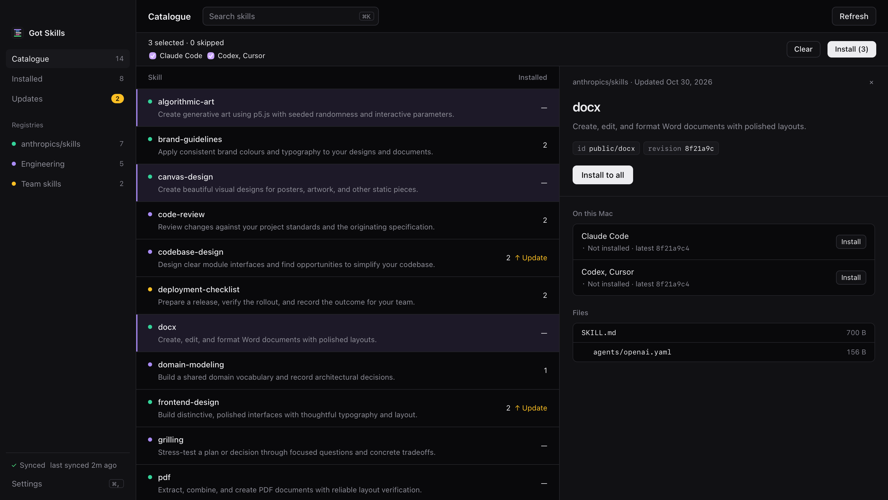
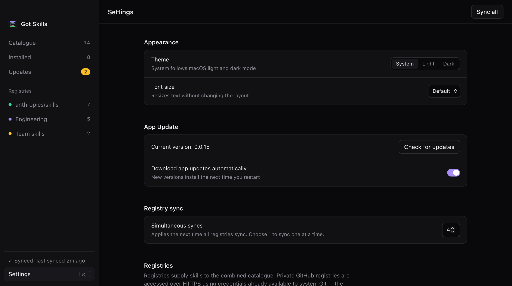

<h1> Got Skills</h1>

**The easy way to manage your AI agent's skills.**

A macOS app for browsing, installing, and updating agent skills for Claude Code, Cursor, Codex, Goose and many more. No command line needed.



_See installed folder counts and update alerts at a glance. Open a skill for each agent's status, actions, and files._



_Manage Git and local folder registries, friendly names, colours, and automatic skill updates._

<details>
<summary>Bulk installation and appearance settings</summary>



_Select several skills, choose their destination folders, and install them together._



_Choose a theme and font size, control app update downloads, and set simultaneous registry syncs._

</details>

_Screenshots use example catalogue data._

---

## Features

- **One catalogue, many registries.** Browse Catalogue, Installed, and Updates
  from the sidebar, search skills, and filter by registry. See each registry's
  skill count and sync health. The Installed column counts destination folders
  and flags skills that need attention; open a skill for each agent's status.
- **Git repositories and local folders.** Add your own, your team's, or a public
  skill repository and choose its branch. Or add a local folder: Got Skills
  watches for changes and picks up uncommitted edits automatically.
- **Install to every agent on your Mac.** Got Skills detects the agents on
  your Mac and installs a copy into each agent's skills folder. Agents without a
  folder of their own, such as Cursor and Codex, share one folder,
  `~/.agents/skills`, so a single install there reaches them all. Install to one
  folder or to all of them in one click. Settings lists every supported agent,
  its folder and whether it's detected.
- **Install several skills at once.** Use ⌘-click to select individual skills or
  ⇧-click to select a range, choose the destination folders, and install the
  selection. Skills already in every chosen folder are skipped; partially
  installed skills go into the missing folders. Follow progress or cancel after
  the current skill.
- **Updates in one go, or automatically.** The Updates view lists out-of-date
  skills and lets you update them all in one run. Turn on Auto Update for a
  registry to update its installed skills after successful syncs. It's off by
  default, and results and failures are shown in the catalogue.
- **Read skills before installing.** Open a skill's detail panel to browse its
  files, preview Markdown, switch to raw text, and read supporting scripts.
  Install, update, repair, or remove skills for individual destination folders.
- **Registries your way.** Give registries friendly names and colours, sync
  them individually or together, and disable a registry while keeping its
  installed skills visible. Set how many registries sync at once in Settings.
- **Adjust the interface.** Choose light, dark, or system appearance and one of
  four font sizes. Press ⌘K to search and ⌘, to open Settings.
- **App updates built in.** Check for new Got Skills releases in Settings,
  control automatic downloads, and restart to apply a downloaded update.
- **Private registries.** Uses the credentials system Git already has. The app
  never stores a token or account.
- **Works offline.** The app keeps the last good snapshot of each registry.
  When a sync fails, you can still browse it and explicitly allow installations
  or updates from that snapshot.
- **Conflicts stay visible.** Skills with the same name from different
  registries remain separate catalogue entries. If a destination already holds
  that name from another registry or outside the app, installation is blocked
  until the existing skill is removed.

## Get the app

Download the latest `.dmg` from
**[Releases](https://github.com/joshystuart/gotskills/releases)**, open it,
and drag **Got Skills** to your Applications folder. The universal DMG runs on
Apple Silicon and Intel Macs.

---

## For developers

Requires **macOS**, **Node.js 24+** and a stable **Rust** toolchain.

```bash
cd app
npm ci
npm run dev          # run with hot reload
```

From the repository root, run `npm run check` before submitting changes. It checks
formatting, TypeScript, renderer and script tests, Rust tests, and the app size
check's tests.

| Command                 | Output                                                                    |
| ----------------------- | ------------------------------------------------------------------------- |
| `npm run build`         | Unsigned `.app` and DMG (local verify only; Gatekeeper blocks other Macs) |
| `npm run build:release` | Signed, notarized bundles plus updater artifacts (needs credentials)      |
| `npm run typecheck`     | Type-check without emitting                                               |
| `npm test`              | Run the renderer and script tests                                         |
| `npm run test:rust`     | Run the Rust tests in `src-tauri`                                         |

The domain vocabulary (registries, snapshots, conflicts, collisions, skill
identity) is documented in [CONTEXT.md](CONTEXT.md) and [docs/adr/](docs/adr).

---

## License

[MIT](LICENSE) © Josh Stuart
